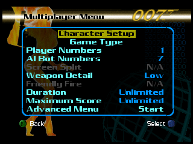
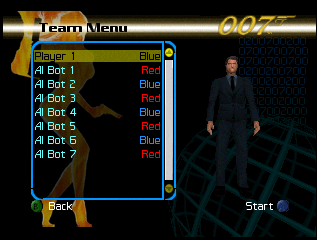
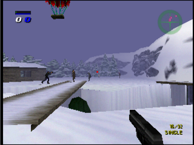
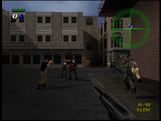
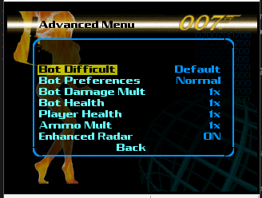
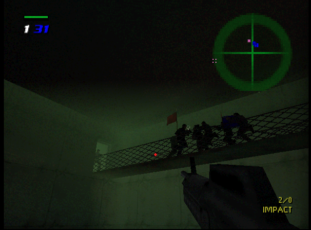

# 007: The World Is Not Enough – 7 Bots Hack

A hack for **The World Is Not Enough** (Nintendo 64) that enables **up to 7 bots** in multiplayer matches.

<!-- Screenshots: 2x2 grid -->
| | |
|---|---|
|  |  |
|  |  |


## About

A few years ago, I found leftover code in the game suggesting that more than 3 bots may have been planned for multiplayer. This patch is the result of that investigation.

Original discussions:
- [GameFAQs](https://gamefaqs.gamespot.com/boards/914163-007-the-world-is-not-enough/80497023)
- [Shooters Forever](https://www.shootersforever.com/forums_message_boards/viewtopic.php?t=8244)


> **Disclaimer:** This hack is solely intended to improve the **multiplayer** experience. Single player mode has **not been tested** and may not work correctly.


## Usage

Apply `twine_7bots.bps` to the original ROM:

```
007 - The World Is Not Enough (USA).z64
MD5: 9d58996a8aa91263b5cd45c385f45fe4
```

Tested with:
- [Hack64 Patcher](https://hack64.net/tools/patcher.php)
- [RomPatcher by Marc Robledo](https://www.marcrobledo.com/RomPatcher.js/)


## New Features

- **1 human + 7 bots** (8 participants) in a single match.
- **All levels, maps, modes and weapons unlocked** — no cheat device required.
- **Neutral skins** and **mixed character types** allowed; two slots may pick the same character.
- **Randomized spawn** — each participant is placed with a small random offset (up to ±0.5 units in X/Z) around the spawn point, so the 8 players no longer stack on top of each other.
- A new menu called **Advanced Options screen** (reachable from the Multiplayer menu) with:
  - **Bot Difficult** — Default, Walkers Easy, Easy, Walkers Hard, Hard, Very Hard.
  - **Bot Preferences** — Normal, Snipers, Pistols, Explosives.
  - **Bot Damage Mult** — 0.5x to 10x; scales explosion damage (the usual cause of instant bot deaths).
  - **Bot Health** — 0.1x to 50x (1x default).
  - **Player Health** — 0.1x to 50x (1x default).
  - **Ammo Mult** — 1x, 2x, 4x, 5x; scales both the magazine capacity and the fire rate (capped at 120 rounds).
  - **Enhanced Radar** — OFF / ON; a slightly larger radar with smaller, better dots.  
  

## Bug Fixes

- Removed the engine's **6-participant limit** (the asset list was colliding with the game-mode byte).
- Fixed the **asset-list terminator** — entering a team mode (e.g. Capture the Flag) from boot no longer hangs.
- Participants **4 to 7 are now drawn and can be hit** (they used to be invisible and bullets passed through them).
- Fixed the **bot HUD leaking into the human's view**.
- Fixed a **freeze caused by a floating-point exception** (the objective position was being overwritten by the controller read).
- Fixed the **hang on maps with fewer spawn points than participants**.
- Fixed the **Character Setup screen hang**.
- Fixed the **participant body being marked for deletion**.
- Fixed **friendly fire** handling with 8 players.
- Fixed the **score going to -1** when you are killed in Arena.
- Fixed the **CTF flags not appearing on the posts**.
- Fixed the **4th row of the character list** showing the wrong label.
- Fixed **option value text truncation** ("Slo" / "Low ") after changing an option.
- Fixed **kill/death attribution** when several players damage the same target.
- Fixed the **radar/preset state block** overlapping the live damage table, which could corrupt damage multipliers.
- Fixed the **Ammo Multiplier 2x** value and clamped ammo at 120 rounds.
- Fixed the **Normalized explosion damage**: a direct explosion no longer one-shots a bot with boosted health.
- Fixed the **Character Setup giving irrelevant information** by removing the line.


## Known Issues

- **Black loading screen** — cosmetic, accepted as a side effect of the fix for the bot HUD.
- **Rare random freeze** — happens occasionally during a match; the radar/preset state collision was fixed, so it should be less frequent, but it is still under investigation.
- **Scoreboard positions** are not always correct (the position shown on respawn and in the pause menu).
- **Initially selected bots are poor choices.**
- **Single player** has not been tested.


## Roadmap



- [x] Make a character's spawn "random" within an area near the Spawn Point
- [x] Bot Health multiplier (0.1x–50x)
- [x] Enhanced Radar (OFF/ON, larger radar with better dots)
- [ ] Visual presets / "Night" mode (Blue Fog, Toxic, Sepia, Yellow Mist, Red Mist, Blackout)
- [ ] Fix the rare random freeze
- [ ] Fix the scoreboard positions (respawn and pause menu)
- [ ] Bot Speed Multiplier
- [ ] Player Speed Multiplier
- [ ] New option: Automatic Weapons (make all weapons automatic)
- [ ] Long-range bot aiming (v1.1 — built and under validation to the next version)
- [ ] Advanced Menu pages: Bots / Player & Ammo / Enhancements
