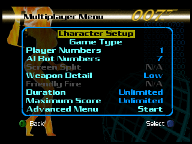
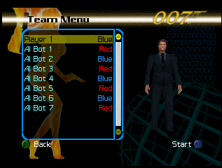
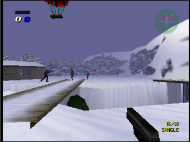
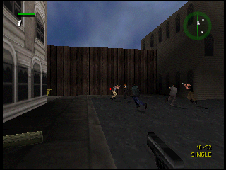

# 007: The World Is Not Enough – 7 Bots Hack

A hack for **The World Is Not Enough** (Nintendo 64) that enables **up to 7 bots** in multiplayer matches.

<!-- Screenshots: 2x2 grid -->
| | |
|---|---|
|  |  |
|  |  |

## About

A few years ago, I found leftover code in the game suggesting that more than 3 bots may have been planned for multiplayer. This patch is the result of that investigation.

Original discussions:
- [GameFAQs](https://gamefaqs.gamespot.com/boards/914163-007-the-world-is-not-enough/80497023)
- [Shooters Forever](https://www.shootersforever.com/forums_message_boards/viewtopic.php?t=8244)

> **Disclaimer:** This hack is solely intended to improve the **multiplayer** experience. Single player mode has **not been tested** and may not work correctly.

## New Features

- **1 human + 7 bots** (8 participants) in a single match.
- **All levels, maps, modes and weapons unlocked** — no cheat device required.
- **Neutral skins** and **mixed character types** allowed; two slots may pick the same character.
- **Character Setup** description line removed.
- **Advanced Options screen** (new, reachable from the Multiplayer menu) with:
  - **AI Difficulty**
  - **Ammo Multiplier** — scales both the magazine capacity and the fire rate
- **Capture the Flag is complete**: flags sit on the base posts and both flags and bases show up as blips on the radar.
- **Kill credit works**: the scoreboard credits the player who actually got the kill.

## Bug fixes

- Removed the engine's **6-participant limit** (the asset list was colliding with the game-mode byte).
- Participants **4 to 7 are now drawn and can be hit** (they used to be invisible and bullets passed through them).
- Fixed the **bot HUD leaking into the human's view**.
- Fixed a **freeze caused by a floating-point exception** (the objective position was being overwritten by the controller read).
- Fixed the **hang on maps with fewer spawn points than participants**.
- Fixed the **Character Setup screen hang**.
- Fixed the **participant body being marked for deletion**.
- Fixed **friendly fire** handling with 8 players.
- Fixed the **score going to -1** when you are killed in Arena.
- Fixed the **CTF flags not appearing on the posts**.
- Fixed the **4th row of the character list** showing the wrong label.

## Usage

Apply `twine_7bots.bps` to the original ROM:

```
007 - The World Is Not Enough (USA).z64
MD5: 9d58996a8aa91263b5cd45c385f45fe4
```

Tested with the [Hack64 Patcher](https://hack64.net/tools/patcher.php).

## Known Issues

- **Black loading screen** — cosmetic, accepted as a side effect of the fix for the bot HUD.
- **Rare random freeze** — happens occasionally during a match; under investigation.
- **Scoreboard positions** are not always correct (the position shown on respawn and in the pause menu).
- **Initially selected bots are poor choices.**
- **Single player** has not been tested.

## Twine ToDo

- [ ] Make a character's spawn "random" within an area near the Spawn Point (avoids spawning everyone in the same place)
- [ ] Bot Speed Multiplier: 0.5x, 0.75x, 1x, 2x, 4x, 5x
- [ ] Player Speed Multiplier: 0.5x, 0.75x, 1x, 2x, 4x, 5x
- [ ] Bot Health Mult.: 0.25x, 0.5x, 1x, 2x, 4x, 8x
- [ ] Radar Enhanced: OFF, ON -> make the radar slightly bigger, with smaller and better dots
- [ ] Fix random crashes
- [ ] "Night" mode
- [ ] New option: Automatic Weapons \[OFF|ON]
- [ ] Fix scoreboard positions (both the position shown on respawn and in the pause menu) -> minor
